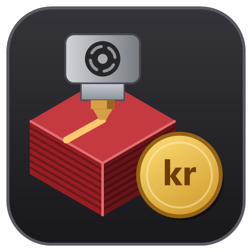
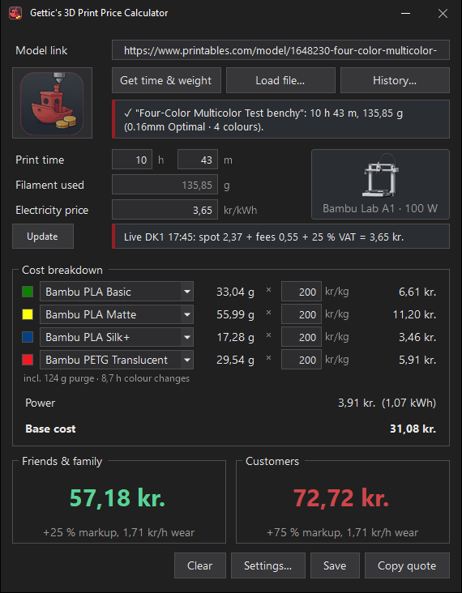
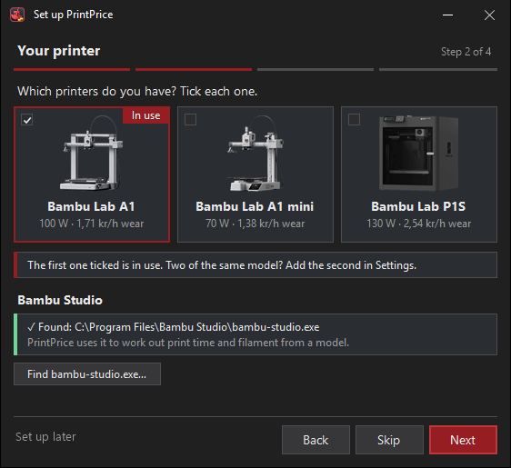
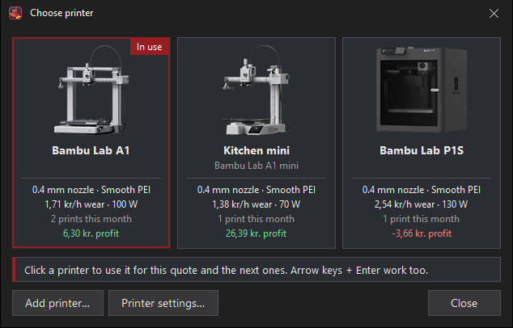
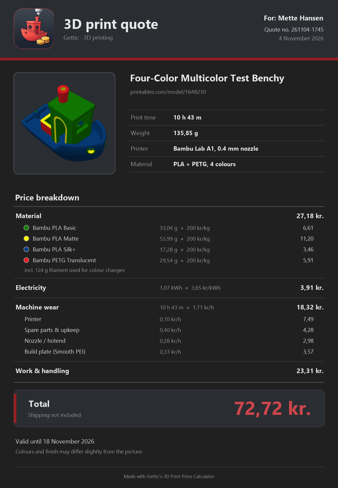
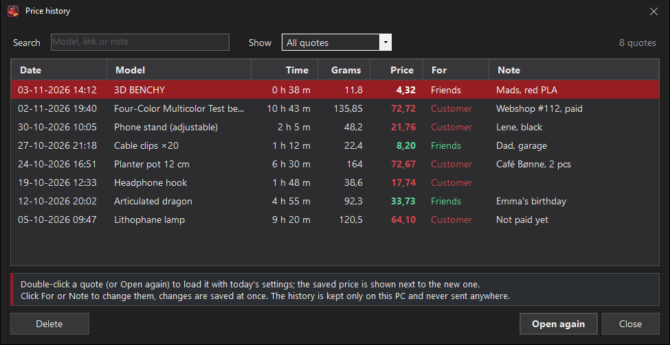

<p align="center"></p>

# Gettic's 3D Print Price Calculator

> [!NOTE]
> **AI disclaimer:** This app, including its code, logo and documentation, was made with the help of AI. It has been tested, but it may still contain mistakes. The prices it calculates are estimates, so check them before you send a quote.

A small dark-mode Windows app that turns a 3D print job into two price quotes: one for **friends & family** and one for **customers**. It's made for the **Bambu Lab A1**, **A1 mini** and **P1S**, and Danish prices (DKK).

<p align="center"></p>

## Download
Download **`PrintPrice.zip`** from the [latest release](../../releases/latest), unzip it and run **`PrintPrice.exe`**. Nothing needs to be installed: Windows 10/11 already includes what it needs (.NET Framework 4.8).

The exe isn't code-signed, so the first time you run it Windows SmartScreen may warn you. Click **More info → Run anyway**.

**Optional:** install [Bambu Studio](https://bambulab.com/en/download/studio) to detect print time and filament use automatically.

**First start:** on a new PC, a short setup window opens before the main window. It has 4 steps and a summary:

| Step | What you set |
|---|---|
| 1 | Language (English or Dansk). **Restore a backup…** if you used PrintPrice before |
| 2 | Which printers you have (A1, A1 mini, P1S; tick each one), and whether Bambu Studio was found |
| 3 | Your filament price, and a live (DK1 or DK2) or fixed electricity price |
| 4 | Markups, minimum price and your name on quotes, with an example price |

- **Back**, **Skip** and **Next** are on every step. **Skip** keeps the default for that step.
- If Bambu Studio isn't found, step 2 has a **Download Bambu Studio** link and **Find bambu-studio.exe…**.
- A restored backup with settings ends the setup. A backup with only the price history lets you carry on.
- **Set up later** (or closing the window) keeps the defaults. The main window then shows "Setup skipped – run it now" once.
- Run it again any time from **Settings → App → Run setup again…**. It fills in your answers, and only adds printers, never removes them. A new language takes effect after a restart (PrintPrice restarts when you save).
- If you already use PrintPrice, you never see it after an update.

<p align="center"></p>

## Website
There is also a calculator in the browser: [gettic.github.io/PrintPrice](https://gettic.github.io/PrintPrice/). Type the print time, grams, kr/kg and the electricity price, and you get both prices and the cost breakdown. It is in English and Danish. Settings are kept only in that browser.

**Size:** the first visit downloads about 3.2 MB (gzip) or 2.6 MB (brotli, used when the browser allows). The browser unpacks the brotli files with Google's small Brotli decoder, included with the site. The decoder runs in your browser and sends nothing.

**Sliced files:** drop a sliced `.gcode.3mf` or a G-code file on the page, or choose one. G-code from Bambu Studio, OrcaSlicer, PrusaSlicer (and SuperSlicer) and Cura can be read. It fills in the print time, the grams, one row per colour (the kr/kg of each filament is remembered) and the plate picture.
- The file is read in your browser only and is never uploaded. Big files are read in parts.
- A sliced `.3mf` with 2 or more plates shows one line per plate under the file line, for example "Plate 2 'Wheels' – 1 h 20 m, 34 g, 3 objects". The price is for all the plates together. After 8 plates the rest show as "+N more".
- An unsliced STL or 3MF gets a message to slice it first and export the sliced plate.
- A file from another slicer than Bambu Studio shows a muted note that the time is that slicer's estimate. Grams worked out from the filament length are marked with "≈". Cura files give no colours.
- PrusaSlicer's binary `.bgcode` can't be read. The message says to export plain `.gcode`.
- G-code made for a printer that isn't a Bambu Lab one is accepted, with a warning that the time is for that printer.
- A file with only the time or only the weight fills in what it has. The other box stays empty, with "Couldn't find the … in the file: type it in.", and there is no price until it's typed.
- A file with impossible numbers (over 30 days or 20 kg) is refused.
- A file sliced for another of your printers shows a warning and a button to switch printer. Unsupported printers are refused, like in the app.

**Live electricity price:** under **Electricity price**, the **Update** button fetches the current Danish price, with a line that shows what it is made of. **Settings → Electricity** has the price area (DK1 or DK2), tariffs and fees, 25 % VAT, and **Fetch the live price when the page opens**. If the price service is busy or can't be reached, the page keeps the price you typed.

**History:** the **History** tab is the price history of the Windows app in the browser.
- **Save to history** on the calculator saves the quote. The tab has the search, the **Month**, **Show** and **Printer** filters and the month cards. In the list you can change **For**, **Note**, **Printed** and **Failed**, **Delete**, **Open again** and **Repeat print**. Failed prints pay themselves back, like in the app.
- **Delete several:** tick quotes (or **Tick all shown**) and click **Delete 3 ticked…** (with your number). On a phone, **Select** turns on the tick boxes. **Clear all…** (next to **Backup…**) deletes every quote. It keeps a safety copy in the browser first, with the pictures (the newest 3 are kept), and offers **Download**. Both ask first, and **Undo** brings the quotes back until the page is reloaded.
- **Views:** **List**, **Medium** or **Large** pictures, remembered in the settings.
- On the site there is no slicing, so **Repeat print** uses the saved time and grams with today's prices. Drop the sliced file again to update them.
- Each saved job keeps a small picture (256 px). The list shows it (bigger when you point at it), and so do Open again, Repeat print, Quote… and Invoice…. A job without a picture shows a cube.
- The history is kept in this browser only, in the same `history.json` format as the desktop app. Clearing the browser's site data deletes it. Safari can delete a site's storage after 7 days without a visit.

**Backup and restore:** **Backup…** on the History tab opens the Backup window, like the app's.
- **Back up** saves a `.printprice-backup` file that the Windows app can restore too. It is not locked with a code and holds customer names and payment details, so keep it private. Or back up **online** with the same 20-character code as in the app. The code is typed each time and the site never remembers it. The backup is locked in your browser before it is sent.
- **Restore** takes a `.printprice-backup` (from the site or the app), the app's `history.json`, or an online code. Choose **Merge** or **Replace**, and optionally **Also restore the settings**. A safety copy of what was there is kept first, and you can download it afterwards.
- Backups hold each job's small picture too, both ways with the app. A file backup takes the newest pictures first, up to 20 MB, and an online backup the newest that fit. **Merge** keeps pictures already in the browser, **Replace** uses the backup's. The safety copy includes the pictures, and Restore shows how many pictures a backup has.
- A **Last backup** line under the list reminds you to back up. It turns into a warning if you never backed up or the last backup is over 30 days old.

**Quote and invoice:** **Show quote…** on the calculator, and **Quote…** and **Invoice…** on the History tab, open the A4 page, like the app's.
- Type the customer's name, choose the **Customers** or **Friends & family** price, and choose a **Dark** or **Light** look.
- **Print / PDF…** opens the browser's print window. Choose "Save as PDF" there. It is always one light A4 page. **Copy text** copies the quote as text. **Save to history** saves it.
- An invoice needs the customer's name. It gets its random invoice number when it is made, and ticks **Printed**.
- **Settings → Quote & invoice** has the name on the quote, **Valid for**, **Pay within**, MobilePay and bank account. MobilePay and bank account show on invoices only when filled in.

It does less than the Windows app: no slicing.

The site runs in your browser. It stores your settings and price history in the browser's own storage. Files you drop on it are read on your PC and never leave it. The only link you click is **GitHub** at the bottom, and nothing is sent before you click it.

The one outside service the site calls is PrintPrice's small Cloudflare relay (`printprice.gtd-relay.workers.dev`). It is used for the live electricity price, where it is sent the price area (DK1 or DK2) and nothing else, and for online backup, and only when you use it. For online backup it gets only the locked copy and a storage id made from the code, never the code. Cloudflare sees your IP address, like any website does, and the relay keeps only a salted hash of it, as described under Privacy. Turn the live price off in **Settings → Electricity**: then the page only asks when you click **Update**.

## Linux and Steam Deck
The Windows app isn't tested under Wine or Proton. Use the website instead, in any browser: [gettic.github.io/PrintPrice](https://gettic.github.io/PrintPrice/). To fill in time and grams from a model, slice it in Bambu Studio for Linux (Flathub `com.bambulab.BambuStudio`, or the AppImage) or in OrcaSlicer, PrusaSlicer or Cura, export the sliced plate, and drop the `.gcode.3mf` or `.gcode` file on the site.

## Features
- **Print time & filament from a link:** paste a **Printables** link and the app downloads the model and slices it in Bambu Studio with the profiles of the printer in use.
  - **MakerWorld** needs you to sign in to download. A MakerWorld link shows how: open the page, click **Download (3MF)**, then drop the file on the window or use **Load file…**. Colours and plates are read from the file. **Open the page** opens the link in your browser.
  - **Other sites** (Thingiverse, Cults3D…) block automatic downloads. Download the STL/3MF yourself and drop it on the window instead.
  - **Several files and colours:** pick 2 or more files on a Printables model, or drop or load 2 or more model files, and the **Choose files and colours** window opens.
    - Tick the files to print. Each plain model file gets a filament and a colour: click the colour swatch for a menu of 13 filament colours. By default every file gets the filament chosen in Settings.
    - Files with the same filament and colour count as one colour row. A `.3mf` or G-code keeps the colours in the file ("colours from the file").
    - **Print together on one plate (AMS lite)** is off by default. It needs 2–4 different colours. It is much slower and uses more filament for colour changes: in tests about 4× the time and 3.7× the filament.
    - If the files don't fit on one plate together, or slicing them together fails, each file is sliced on its own plate instead. A yellow note says "Sliced one by one instead.", with the reason in its tooltip.
  - **Plates:** when the price covers 2 or more plates (a file with several plates, or several files sliced one by one), a link under the result says "The price is for both plates – show them" (or "all N plates" for 3 or more). It opens a list with one line per plate: name, time in h and m, grams and the number of objects. Point at a line to see the object names.
  - **Already-sliced `.gcode.3mf` files** are read instantly, without slicing again. A file sliced for another of the supported printers is priced, with a warning.
  - **G-code from other slicers:** drop a `.gcode` on the window, or pick it with **Load file…** (one G-code at a time). Files from Bambu Studio, OrcaSlicer, PrusaSlicer (and SuperSlicer) and Cura are read for print time, grams, and colours and filament types where the file has them. Cura gives no colours.
    - A file from another slicer than Bambu Studio shows a grey note that the time is that slicer's estimate. Grams worked out from the filament length show as an estimate, for example "≈ 11,7 g".
    - A G-code made for a printer that isn't a Bambu Lab one is priced, with a warning that its time is for that printer.
    - PrusaSlicer's binary `.bgcode` isn't read. The message says to export plain `.gcode`.
    - A file with only the time or only the weight fills in what it has. The other box stays empty, with "Couldn't find the … in the file: type it in.", and there is no price until it's typed. A file with impossible numbers (over 30 days or 20 kg) is refused.
    - A dropped or loaded file shows its name in the **Model link** box. The full path is in the tooltip.
  - **Printers PrintPrice doesn't support yet:** a sliced file made for another printer (for example X1 Carbon or H2D) is not priced. You can ask for your printer to be added by opening an issue at [github.com/gettic/PrintPrice/issues](https://github.com/gettic/PrintPrice/issues). The message has the link.
  - **Model too big:** if the model doesn't fit the printer (or a plate in the file is empty), the message says so and shows the build volume: A1 256 × 256 × 256 mm, A1 mini 180 × 180 × 180 mm, P1S 256 × 256 × 250 mm.
  - **Plate and filament:** if Bambu Studio won't print a filament on the chosen build plate, the message names the filament and the plate. Pick another plate in Settings > Printer, or another filament.
  - **Multi-colour prints:** if the model uses 2 or more filaments, the Cost breakdown shows one row per colour with its own kr/kg box. A line below shows the purge waste and the time spent on colour changes (for example "incl. 124 g purge · 8,7 h colour changes"). With more than 4 colours the rest are grouped in one "+N more" row. Colours for which the sliced file names no real filament (empty, or just generic PLA) get the filament chosen in Settings (default Bambu PLA Matte). Filaments the file names are kept. Several model files are added together (see Several files and colours above). **Filament used** becomes the read-only total.
  - **Empty link:** if you press **Get time & weight** with an empty link box, a red "Paste a link or load a file first" hint shows in the box. After 10 seconds the grey example link comes back. The empty box says "Paste a Printables link, or press Enter for an example". Pressing Enter there slices a 4-colour Benchy straight away, without the file picker, and gets its time and weight, so you can see the multi-colour rows.
  - **Model picture:** a small picture of the model shows under the Model link: the Printables photo, or the picture inside a `.3mf`. After slicing, it switches to Bambu's render of the plate. Without a model it shows the logo.
- **Open in Studio:** after a successful slice, the **Get time & weight** button becomes **Open in Studio**. It opens the sliced file in Bambu Studio's Prepare tab with the same printer profiles. Click **Slice plate** there before you print. If you used several model files, the first one opens, or the one shared plate when they were printed together. An already-sliced `.gcode.3mf` opens your own file. Editing the link, **Clear**, **Load file…**, opening a quote from History or changing the slicing settings turns the button back into **Get time & weight**. Enter in the link box does what the button shows.
- **Material rows with remembered prices:** the Cost breakdown starts with one material row per colour (one row for a one-colour print). Each row has a colour swatch, a drop-down with the full filament name (Bambu Studio's filament profiles for the printer in use), the grams, and a kr/kg box. Picking another material changes only that row and fills in its last kr/kg, with no new slicing. The app remembers one kr/kg price per filament (for example Bambu PLA Matte = 200). A filament you have never priced uses the last filament price. The filament chosen in Settings is the default for new slices.
- **Several printers:** add a Bambu Lab A1, A1 mini or P1S, as many as you like. Each printer has its own name, nozzle, print profile, build plate, power and wear rate. Markups, minimum price, failed prints, electricity and filament prices are the same for all printers.
  - **Printer card:** right of the print time and electricity rows, a card shows the printer in use and its power ("Bambu Lab A1 · 100 W"). The photo comes from your installed Bambu Studio, otherwise a drawn printer is shown.
  - **Choose printer:** click the card to open this window. It has a tile per printer with its picture, name, model, nozzle and plate, wear rate and power, and this month's prints and profit. Click a tile (or use the arrow keys and Enter) to use that printer for this quote and the next ones. With many printers the tiles scroll.
  - **Add printer…** in that window opens Settings to add one, and puts it in use. **Printer settings…** opens Settings > Printer.
  - **Changing printer after slicing:** a yellow note asks you to get time & weight again for the new printer.

<p align="center"></p>

- **Live electricity price:** the current 15-minute spot price for DK1/DK2 comes from Energinet's free [Energi Data Service](https://www.energidataservice.dk/). The app adds your tariffs, taxes and fees, then 25 % VAT.
- **Wear & tear:** a machine-time rate is worked out from the printer in use and the chosen **nozzle**, **filament** and **build plate**. It is added to both prices.
  - **Abrasive filaments:** the app knows which filaments are abrasive (CF, GF, Glow…) and warns if one is used on a stainless steel nozzle.
- **Failed prints:** optional. Set a % in Settings and material and power are raised by it for failed prints and reprints, before the markup. The default is 0 % (off). When it is above 0, the Cost breakdown shows a "Failed prints" line.
- **Failed prints payback:** on by default. In the price history, tick **Failed** on a saved quote. With **Earn back failed prints** on in Settings, new quotes get a payback of 10 % (**% per quote**) of material + power until the failed print's material, power and wear are made back. It never adds more than what is left. It is shown as **Failed prints payback** in the Cost breakdown, is not marked up, and is added after the minimum price and before rounding. **Paid by** is **Customers only** (default; only quotes saved For = Customer count) or **Both prices**. Settings shows **Not made back yet**. A saved quote counts as sold, so delete quotes you didn't sell.
- **Configurable:** Settings has five tabs: **Prices** (markups, minimum price, rounding, failed prints), **Printer** (which printer, name, nozzle, print profile, filament, build plate, power, wear rate), **Electricity** (price area, tariffs and fees, VAT, live price at start), **Quote & invoice** (name on the quote, valid days, invoice due days, MobilePay, bank) and **App** (language, update check, Bambu Studio path, backup, and **Run setup again…**).
  - On the **Printer** tab, the **Printer** drop-down picks which printer you edit; the one in use is marked "(in use)". **Add…** adds an A1, A1 mini or P1S with that model's defaults. **Remove** removes the printer shown (only when you have 2 or more).
  - Each printer's **Name** is shown on the printer card and the quote. Left empty, the model name is used. The filament profile is the same for all printers.
- **English or Danish:** under **Sprog / Language** in Settings choose Automatic (Danish if Windows is Danish, otherwise English), English or Dansk. It takes effect after a restart; **Restart now** does it at once. The whole program and the copied quote are translated.
- **Quote page:** **Show quote…** opens a window with a live preview of an A4 quote page: logo, model picture, print time, weight, printer, material, a full price breakdown (material per colour, electricity, machine wear split into printer / spare parts / nozzle / build plate, "Work & handling", and failed prints payback, minimum price or rounding when used), the total, a quote number, a valid-until date and small print.
  - **For:** an optional customer name (recent names from the history are offered).
  - **Price:** Customers or Friends & family.
  - **Look:** Dark (default) or Light for the picture. The PDF is always light.
  - **Export:** **Copy picture**, **Save picture…**, **Save as PDF…** or **Copy text**. The **▾** on the button gives the same four as quick exports without a name.
  - **Save to history** saves the quote with the chosen price and name without making a file. Every export is also saved to the price history. Just opening the window saves nothing.
  - The window is large and can be resized. Click the page to zoom to 100 %, and drag to move around.
  - The name on the quote, the number of days it is valid (default 14) and the printer name are set in Settings.

<p align="center"></p>

- **Price history:** **Save to history** saves the quote (the status line shows "Saved to history."). **History…** (next to **Load file…**) lists the saved quotes.
  - **Month** picker (all months or one month, ‹ › to step) with six cards for that month: prints and failed prints, print time and filament, customers, friends & family, costs (material + power + wear) and profit with % of income.
  - **Printer:** every saved quote keeps its printer. Quotes saved before there were several printers count as your first printer. With 2 or more printers, the list gets a **Printer** column and a **Printer** filter. With one printer picked, the cards show that printer's totals (**All months** = all time). With **All printers**, the Profit card's tooltip lists the profit per printer. A removed printer is shown as "(removed)".
  - Profit per printer = price − material − power − that printer's wear. A failed print counts as a loss on its own printer.
  - You can search and filter the list. One **Price** column shows the friends & family or the customer price, following each row's **For** choice (Customer by default). **Esc** in the search box clears it.
  - **For** and **Note** can be edited in the list and are saved at once.
  - **Printed** and **Failed** are tick columns. Click to tick. Quotes saved before **Printed** existed count as printed. Failed quotes feed the payback (see Failed prints payback above).
  - **Views:** the switch top right shows a **List**, **Medium pictures** or **Large pictures**. Ctrl+1, 2, 3 or Ctrl+mouse wheel switch too. The view is remembered. **For** and **Note** are edited in the list view.
  - **Select several:** Ctrl+click, Shift+click or Ctrl+A. **Delete** (or the Delete key) deletes the selected quotes. In the right-click menu, **For**, **Printed** and **Failed** change all selected quotes.
  - **Clear all…** deletes every quote, also the ones the filters hide. It first saves a safety copy with all pictures: `%APPDATA%\PrintPrice\history.before-clear-<date>-<time>.printprice-backup`. Every copy is kept. Later, **Backup…** › **Restore** › **Browse…** opens at the newest copy.
  - Delete and Clear all ask first. Afterwards a line says what was deleted (for example "✓ 3 quotes deleted."), with **Undo**. Undo brings back the last delete while the window is open (a new delete or **Backup…** ends it). After Clear all, **Open folder** shows the safety copy.
  - Deleting a failed print that isn't earned back yet stops the payback for it. Deleting a quote that paid back part of a failed print makes that amount owed again.
  - **Quote…** opens the quote page of a saved quote with its saved prices.
  - **Invoice…** makes a bill: the title is Invoice, with a random invoice code (for example 2026-K7Q4), the invoice date and a due date. A customer name is required ("Bill to"). A **Payment** block with MobilePay and/or bank details shows only if you set them in Settings. Making an invoice ticks **Printed**. The code shows in the **Invoice** column. The due date and payment details are kept with the invoice.
  - **Repeat print** prices the same print again with today's filament and electricity prices and slices the saved link or file again. If that isn't possible, the saved time and weight are used, with a note. The info box shows "Was … → now …". A repeat is never merged with its original. A job with several files slices each file again with its saved filament and colour, and together on one plate if it was before. The plates link comes back too.
  - **Open again** (or double-click, or Enter) puts the inputs back, including the filament name and colour, and recalculates with today's settings. The model box shows the saved price next to today's. Open again and **Repeat print** switch back to the quote's printer, if you still have it.
  - **Picture:** each saved job keeps a small picture (256 px) of the model in `%APPDATA%\PrintPrice\pictures`. The list shows it (point at it for a bigger one), and so do **Open again**, **Repeat print** and a saved job's **Quote…** / **Invoice…**. A job without a picture shows a cube. A deleted job's picture goes once the delete can't be undone any more.
  - All actions are also in the right-click menu.
  - The same quote saved again within 10 minutes replaces the last one. The newest 5000 quotes are kept.
  - Saved quote and invoice files are named `<date> <model> - <name>`.
  - **Backup…** opens the Backup window (also in Settings > App as **Back up…** and **Restore…**). See Backup and restore below.

<p align="center"></p>

- **Backup and restore:** the Backup window has two tabs.
  - **Back up** saves the price history and your settings to a `.printprice-backup` file. The file is not locked with a code, and it holds customer names and payment details, so keep it somewhere private.
  - **Restore** reads a backup file or a `history.json`. **Merge** adds the backup's quotes to the ones on this PC. **Replace** swaps this PC's history for the backup's, and asks first. **Also restore the settings** is possible when the file has settings; the Bambu Studio path stays as it is. **Merge** with an older backup also brings back quotes deleted since.
  - File backups include all the pictures of the saved jobs. Online backups take only the newest pictures that fit the service's size limit. A backup from the website restores its pictures too.
  - A safety copy of the current history and settings is saved first, next to them (`history.before-restore-<date>-<time>.json`).
  - **Online, with a code** sends the encrypted history and settings to the backup service and shows a 20-character code (**Copy**). Keep the code safe: it is the only way to get the backup back, it can't be reset, and anyone who has it can read the backup. This PC remembers the code (**Show code**, **New code…**, **Delete online backup…**) and shows "Last online backup: … · kept until …". A backup is kept 400 days after the last upload. The newest upload replaces the older one, also when it comes from another PC with the same code.
  - **Restore from an online code:** choose **An online code**, type the code and click **Get backup**. **Keep backing up to this code** makes later online backups go to that code.
  - **5 online backups a day.** With 1 or 2 left, a note says so. When the limit is reached, the button counts down to the next one ("Next online backup in 3:20:15").
- **Windows:** every window can be dragged by any empty spot. All text (labels, info boxes, prices, status line) can be marked with the mouse and copied with Ctrl+C or right-click Copy. Double-click marks a word.
- **If something goes wrong:** an unexpected error shows the app's own dark "Something went wrong" window instead of Windows' crash dialog, and the app stays open. **Continue** goes on, **Copy details** copies the error (paste it into an issue; there is a link to report it on GitHub), and **Close PrintPrice** closes the app. Each error is also written to `errors.log` in `%APPDATA%\PrintPrice`, without your user name or profile path.
- **Auto-update:** at startup, and then every 10 minutes while the program is open, the app checks this repo's latest release. If there is a newer version, a red **Update to vX** button appears under the Friends & family price. Click it to see what's new in every version since yours (it scrolls if long), then choose **Update now** or **Later**. The download is verified against GitHub's SHA-256 checksum before it's installed. You can switch the check off in Settings (**Check for new versions automatically**); that switches off the 10-minute check too. Opening Settings also checks once (if the automatic check is on). Next to the version number in Settings, **check now** looks once when you click it. A newer version shows there and as the red update button.

## How prices are calculated
```
Material   = grams / 1000 × filament DKK/kg
Power      = hours × printer kW × electricity DKK/kWh
Base       = (Material + Power) × (1 + failed prints %)
Friends    = Base × (1 + friends markup) + hours × machine-time rate
Customers  = Base × (1 + customer markup) + hours × machine-time rate   (at least the minimum price)
```
The machine-time rate is added to both prices and is not marked up. The minimum price is for customers only. Both prices can optionally be rounded up to the nearest N kr. Failed prints are 0 % by default and do not affect the machine-time rate. The failed prints payback (on by default) is added to the price after the minimum price and before rounding.

**Machine-time rate** (kr per print hour, for the printer in use):

| Part | How it's calculated |
|---|---|
| Printer | printer price ÷ 3.000 h (see the table below) |
| Parts and upkeep (PTFE tube, wiper, cutter, belts, extruder gears, rods/bearings, grease, IPA, glue stick, shipping) | parts price ÷ 1.500 h |
| Hotend | 139 kr. stainless (500 h; ~100 h with abrasive filament) or 185 kr. hardened steel (750 h; 300 h abrasive) |
| Build plate | price ÷ life; PETG/TPU halve the smooth PEI plate's life |

Plate prices and lives: Smooth PEI 200 kr. / 600 h, Textured PEI 150 kr. / 1.000 h, SuperTack 260 kr. / 500 h, Cool 150 kr. / 500 h, Engineering 180 kr. / 800 h.

| Printer | Printer price | Parts price | Plates | Default setup |
|---|---|---|---|---|
| A1 | 2.099 kr. | 600 kr. | full price | 1,71 kr/h |
| A1 mini | 1.599 kr. | 500 kr. | 70 % of the price | 1,38 kr/h |
| P1S | 4.199 kr. | 800 kr. | full price | 2,54 kr/h |

The default setup is a 0.4 stainless nozzle, PLA and the smooth PEI plate. All of these numbers are estimates and live in `src/Pricing.cs`.

## Defaults
| Setting | Default |
|---|---|
| Printer | One Bambu Lab A1 |
| Printer power | A1 100 W, A1 mini 70 W, P1S 130 W (average while printing) |
| Wear rate | A1 1,71 kr/h, A1 mini 1,38 kr/h, P1S 2,54 kr/h (worked out from the printer) |
| Markups | 25 % friends & family, 75 % customers |
| Failed prints | 0 % (off; % of material + power) |
| Minimum price | 50 kr. (customers only) |
| Failed prints payback | On; 10 % per quote; paid by customers only |
| Quote | No name on a new install (set it in the setup or Settings), valid 14 days, customer price, dark picture |
| Invoice | Due after 14 days; MobilePay and bank empty |
| History | List view |
| Language | Automatic (Danish if Windows is Danish, otherwise English) |
| Slicing | 0.4 mm nozzle, 0.16mm Optimal, Bambu PLA Matte, Smooth PEI plate |
| Electricity | DK1, 0,55 kr/kWh fees on top of spot, 25 % VAT |

Settings, including your printers and the remembered kr/kg price per filament, are saved in `%APPDATA%\PrintPrice\settings.ini`.

When you update from an older version, the old untouched defaults move to the new ones once (minimum price 50 kr., earn back failed prints on at 10 %). Values you changed are kept. Your printer settings become printer 1, unchanged. The **Defaults** button in Settings uses the new defaults. On the Printer tab it sets the printer shown to its model's defaults and keeps its name.

## Privacy
The app sends no personal information anywhere. It has no account, cookies or tracking. It only connects to these services:

| Service | When | What is sent |
|---|---|---|
| GitHub | At startup, every 10 minutes while the program is open, and when you open Settings, to look for a new version (all of it can be switched off in Settings); when you click **Update now** | A normal web request with the app name and version. Unchanged answers are not downloaded again (ETag), and if GitHub says "too many requests" the app quietly waits longer |
| Energi Data Service | At startup to get the electricity price (can be switched off in Settings), when you click the price button, or in the setup window's electricity step while the live price is chosen (the default) | The price area (DK1/DK2) |
| PrintPrice's backup service (Cloudflare relay) | Only when you use **Online, with a code** in the Backup window (in the app or on the website): back up, get a backup, new code or delete | The encrypted backup and a storage id made from the code. The backup is locked on your PC (or in your browser) first, and the code itself is never sent |
| Your browser | Only when you click **GitHub** in "Made by Gettic · GitHub" at the bottom of the main window, the issues link in the message about an unsupported printer, **Open the page** in the MakerWorld message, or **Download Bambu Studio** in the setup window | Opens this project's page (github.com/gettic/PrintPrice), its issues page, the MakerWorld page you pasted or the Bambu Studio download page. Nothing is sent before the click |
| Printables | Only when you paste a Printables link | The model's ID, then the file and a small model picture (~10 KB, from media.printables.com) download |

To enforce the 5-a-day online backup limit, the relay keeps only a salted hash of your IP address (not the address itself) for 2 days.

The website sends nothing about you either. Your settings, price history and files stay in your browser. Online backup sends only a locked copy, and only when you use it. The live electricity price is asked from the same relay and only the price area is sent.

Like any web request, these show your IP address to the service. Local `.3mf` files and sliced results use the picture stored inside the file, with no network. Bambu Studio runs on your own PC; the app only starts its command-line slicer, and reads its printer and filament profiles (for slicing and the material drop-down) and the printer pictures from its install folder. This stays on your PC and is never sent anywhere.

Saved quotes (price history) are kept only on this PC in `%APPDATA%\PrintPrice\history.json` and are never sent anywhere. Their small pictures are in `%APPDATA%\PrintPrice\pictures`, also only on this PC unless you put them in a backup. On the website they stay in the browser. Errors are written to `errors.log` in the same folder and are never sent; **Copy details** puts them on the clipboard only when you click it. **Clear all…** in History clears it, after a safety copy. If the file is damaged, the app keeps it as `history.bad-<date>-<time>.json` in the same folder and starts with an empty history.

A backup file holds your price history (customer names), the jobs' pictures and your settings (including MobilePay and bank details). A backup file is written only where you choose to save it and is not locked with a code, so keep it private. An online backup is locked with its code on your PC before it is sent, and nothing is sent unless you click an online button. A restore also leaves safety copies (`history.before-restore-*.json`, `settings.before-restore-*.ini`) in `%APPDATA%\PrintPrice`, and **Clear all…** leaves `history.before-clear-*.printprice-backup` there, with customer names and pictures. Clear all copies are kept until you delete them.

**Open in Studio** starts the Bambu Studio program on your PC with a copy of the sliced file. The copy is kept in `%TEMP%\PrintPrice\studio\` (older copies are deleted) and is never sent anywhere. Bambu Studio may add it to its own list of recent projects.

The **Open folder** link in the Backup window opens Windows Explorer at the saved backup file or safety copy, only when you click it. Nothing is sent.

Quotes and invoices are made on your PC. A quote picture or PDF is written only where you choose to save it, and **Copy picture** and **Copy text** put it on the clipboard. Nothing is uploaded. The invoice codes already used are kept in `settings.ini`.

Nothing is installed. The app writes only its settings file, the price history, the files you save and temporary slicing files. To uninstall, delete PrintPrice.exe and the folder %APPDATA%\PrintPrice.

## Build from source
```powershell
powershell -ExecutionPolicy Bypass -File build.ps1
```
This runs the tests and compiles `bin\PrintPrice.exe` with the C# compiler that ships with Windows, so no SDK or Visual Studio is needed. To regenerate the logo and icon, run `tools\make-icon.ps1`. The switch on its first line picks the AI logo (`'ai'`, made from `assets\logo-master.png`) or the old drawn one (`'drawn'`); line 2 sets the outline colour.

To redraw the README pictures, run `PrintPrice.exe --screenshots <folder>`. This hidden option saves the windows as PNGs in that folder and exits. It uses default settings, never goes online and never saves anything. Add `--lang da` for Danish pictures. A `model.png` in the folder is used as the sample model picture for `main.png`, and a `model2.png` for the multi-colour `main_multi.png`.

For testing, `PrintPrice.exe --settings "<folder>" [--hidden | --minimized]` runs the app on a separate settings folder. The folder is created if missing and starts with defaults. The real `%APPDATA%\PrintPrice` is never touched. There are no update checks or installs, the live electricity price is never fetched (a fixed test price marked "test" is used instead), and the setup window doesn't open. `--hidden` keeps the window off-screen.

### Project layout
| Path | What |
|---|---|
| `src/Pricing.cs` | Price formula and wear model per printer |
| `src/Slicer.cs` | Bambu Studio command-line slicing; merges profile inheritance, which the CLI doesn't do |
| `src/SliceInfo.cs` | Reading sliced files (time, filaments, printer); shared with the website |
| `src/Printables.cs` | Printables API: model files and downloads |
| `src/PowerPrice.cs` | Energi Data Service spot prices |
| `src/Updater.cs` | Update check and install from GitHub releases |
| `src/History.cs` | Saved quotes (price history) |
| `src/HistoryForm.cs`, `src/HistoryViews.cs` | The History window; its pictures and List / Medium / Large views |
| `src/Backup.cs`, `src/BackupForm.cs` | Backup codes and the Backup window |
| `src/OnlineBackup.cs` | Online backup: encrypt, upload, download, delete |
| `worker/` | The Cloudflare relay: online backup and the website's live electricity price |
| `src/PrinterPickerForm.cs` | The Choose printer window |
| `src/QuotePage.cs`, `src/QuoteForm.cs` | The quote and invoice page (picture, PDF) and its window |
| `src/MainForm.cs`, `src/SettingsForm.cs`, `src/UpdateForm.cs`, `src/Theme.cs` | User interface |
| `src/SetupForm.cs` | The first-time setup window |
| `src/FilePickerForm.cs` | The Choose files and colours window |
| `src/ErrorForm.cs` | The "Something went wrong" window and `errors.log` |
| `src/Lang.cs` | English and Danish texts |
| `src/Screenshots.cs` | Hidden `--screenshots` picture mode |
| `tests/PricingTests.cs` | Unit tests |
| `web/` | The website version (reuses the pricing files) |
| `.github/workflows/build.yml` | GitHub Actions: builds and tests the release exe |
| `.github/workflows/pages.yml` | GitHub Actions: publishes the website |
| `LICENSE` | GPL-3.0 |

## License
[GPL-3.0](LICENSE). Copyright (C) 2026 Gettic.

**Third-party code:** the website includes Google's Brotli decoder (`web/wwwroot/brotli-decode.min.js`, from [google/brotli](https://github.com/google/brotli) v1.2.1, MIT licence, kept in the file).
