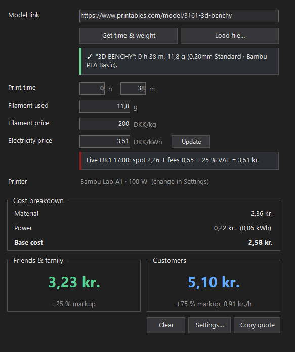

<p align="center"></p>

# Gettic's 3D Print Price Calculator

> [!NOTE]
> **AI disclaimer:** This app, including its code, logo and documentation, was made with the help of AI. It has been tested, but it may still contain mistakes. The prices it calculates are estimates, so check them before you send a quote.

A small dark-mode Windows app that turns a 3D print job into two price quotes: one for **friends & family** and one for **customers**. It's made for the **Bambu Lab A1** and Danish prices (DKK).

<p align="center"></p>

## Download
Get **`PrintPrice.exe`** from the [latest release](../../releases/latest) and double-click it. Nothing needs to be installed: Windows 10/11 already includes what it needs (.NET Framework 4.8).

The exe isn't code-signed, so the first time you run it Windows SmartScreen may warn you. Click **More info → Run anyway**.

**Optional:** install [Bambu Studio](https://bambulab.com/en/download/studio) to detect print time and filament use automatically.

## Features
- **Print time & filament from a link:** paste a **Printables** link and the app downloads the model and slices it in Bambu Studio with A1 profiles.
  - **Other sites** (MakerWorld, Thingiverse…) block automatic downloads. Download the STL/3MF yourself and drop it on the window instead.
  - **Already-sliced `.gcode.3mf` files** are read instantly, without slicing again.
- **Live electricity price:** the current 15-minute spot price for DK1/DK2 comes from Energinet's free [Energi Data Service](https://www.energidataservice.dk/). The app adds your tariffs, taxes and fees, then 25 % VAT.
- **Wear & tear:** a machine-time rate is worked out from the chosen **nozzle**, **filament** and **build plate**.
  - **Abrasive filaments:** the app knows which filaments are abrasive (CF, GF, Glow…) and warns if one is used on a stainless steel nozzle.
- **Configurable:** set the markups, minimum price, rounding, printer power, print profile and price area in Settings.
- **Copy quote:** puts a ready-to-send text on the clipboard.
- **Auto-update:** at startup the app checks this repo's latest release. If there's a newer version, it shows what's new and can update itself in one click. The download is verified against GitHub's SHA-256 checksum before it's installed. You can turn the check off, or check manually, in Settings.

## How prices are calculated
```
Material   = grams / 1000 × filament DKK/kg
Power      = hours × printer kW × electricity DKK/kWh
Base       = Material + Power
Friends    = Base × (1 + friends markup)
Customers  = Base × (1 + customer markup) + hours × machine-time rate   (at least the minimum price)
```
Both prices can optionally be rounded up to the nearest N kr.

**Machine-time rate** (kr. per print hour):

| Part | How it's calculated |
|---|---|
| Printer | 2.100 kr. ÷ 5.000 h |
| Belts, PTFE tube, wiper, grease | 300 kr. ÷ 2.000 h |
| Hotend | 139 kr. stainless (1.000 h; ~100 h with abrasive filament) or 185 kr. hardened steel (1.500 h; 500 h abrasive) |
| Build plate | price ÷ life; PETG/TPU halve the smooth PEI plate's life |

The default setup (0.4 stainless nozzle, PLA, smooth PEI plate) comes to **0,91 kr./h**. All of these numbers are estimates and live in `src/Pricing.cs`.

## Defaults
| Setting | Default |
|---|---|
| Printer power | 100 W (A1 average when printing PLA) |
| Markups | 25 % friends & family, 75 % customers |
| Slicing | 0.4 mm nozzle, 0.20mm Standard, Bambu PLA Basic, Smooth PEI plate |
| Electricity | DK1, 0,55 kr./kWh fees on top of spot, 25 % VAT |

Settings are saved in `%APPDATA%\PrintPrice\settings.ini`.

## Build from source
```powershell
powershell -ExecutionPolicy Bypass -File build.ps1
```
This runs the tests and compiles `bin\PrintPrice.exe` with the C# compiler that ships with Windows, so no SDK or Visual Studio is needed. To regenerate the logo and icon, run `tools\make-icon.ps1`.

### Project layout
| Path | What |
|---|---|
| `src/Pricing.cs` | Price formula and wear model |
| `src/Slicer.cs` | Bambu Studio command-line slicing; merges profile inheritance, which the CLI doesn't do |
| `src/Printables.cs` | Printables API: model files and downloads |
| `src/PowerPrice.cs` | Energi Data Service spot prices |
| `src/MainForm.cs`, `src/SettingsForm.cs`, `src/Theme.cs` | User interface |
| `tests/PricingTests.cs` | Unit tests |
